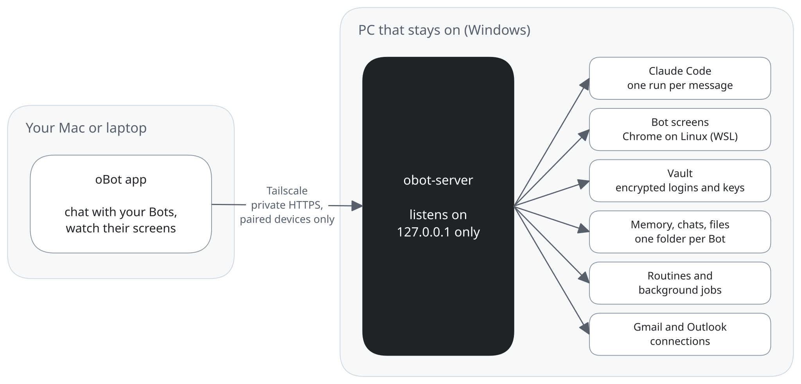

<p align="center"></p>

# oBot

Always-on AI Bots that chat with you and do real work on a computer: browse, sign in, run commands,
handle email and calendar. They run on **Claude Code** with your **Claude subscription** (or an
Anthropic API key). A Rust server and a small Tauri desktop app.

<picture>
  <source media="(prefers-color-scheme: dark)" srcset="docs/images/architecture-dark.svg">
  
</picture>

The diagram's source is [`docs/images/architecture.excalidraw`](docs/images/architecture.excalidraw) (open it at excalidraw.com).

## What Bots can do

* **Chat and remember.** Each Bot is one long Claude Code conversation with its own folder. It keeps a
  small always-loaded **profile** of facts about you and a searchable **log**, and tidies both weekly.
* **Use their own screen.** Each Bot gets a Linux desktop with Chrome. You can watch it live or choose
  **Use screen**.
* **Sign in for you.** Saved **Vault** logins are typed into the login page without the Bot seeing the
  password. If nothing is saved, the Bot shows a **secure form** in the chat.
* **Work in the background.** Routines, check-ins and long commands wake the Bot up when it's time.
* **Work together.** A Bot tells you when another of your Bots fits a task better and passes it on when
  you say so; the other Bot picks it up in its own chat.
* **Reactions and replies.** React to any message with an emoji or reply to it with a quote; Bots see
  both, and can react to your messages too.
* **Group chats.** Put up to 6 Bots in one chat. oBot picks the one Bot whose job fits each message (or the
  Bots you name with @), so you don't get the same answer several times. Say "everyone" to hear from all of
  them. A Bot can bring in another with @Name.
* **Email, calendar and files.** Connected Gmail / Google Calendar / Google Drive and Outlook accounts.
  Bots use all your calendars, add repeating events with reminders and video links, find free time and
  answer invitations; invites show as an event card you send yourself. With Google Drive for desktop on
  your Mac, files a Bot puts in your Drive show up there.
* **GitHub.** Connect GitHub in Settings › Connections (you type a short code on github.com once). Bots read
  your repos, files, issues and pull requests, including private ones, and can work on a copy of the code.
  Comments, new issues and pushes always ask you first.
* **Updates itself.** The Mac app and the always-on PC check GitHub for a new version every few hours
  and show **oBot X is available · Update**; one click installs it (Settings › Updates). The always-on PC also installs
  new versions by itself when no Bot is working (turn off with Settings › Updates › Update automatically). Updates are
  signed, and anything that doesn't match oBot's key is refused. See [docs/releasing.md](docs/releasing.md).
* **Recover from errors.** Temporary errors are retried by themselves. Otherwise you get **Try again**,
  **Edit and resend** or **Start a fresh chat**. Messages sent while a Bot is busy wait as
  **Queued** (tap **Send now** to interrupt it).

Bots use **Sonnet 5.5 at extra-high effort** unless you change it in Settings › General (or per Bot).
Bots get only the tools oBot gives them: your personal Claude Code plugins, MCP servers, skills and
settings on the PC are not loaded into Bots (add MCP servers in Settings › Computer › Plugins). Settings
files a Bot writes in its own folder are ignored too, so it can't give itself permissions. To give a Bot one
of your skills, add it in the Bot's panel under **Skills**, or ask the Bot to copy it into its folder.

## Folders

| Path | What it is |
|---|---|
| `frontend/ui/` | The interface (HTML/CSS/JS, no build step), served by the server. |
| `frontend/desktop/` | The desktop app (Tauri window + built-in local server). |
| `frontend/assets/` | The app icon. |
| `backend/core/` | All server logic: API, Claude Code runner, Bot screens, Vault, storage, security. |
| `backend/server/` | The `obot-server` command. |
| `backend/install/windows/` | `install-host.ps1`: makes a Windows PC the always-on Bot computer. |
| `docs/` | Documentation, starting at [`docs/README.md`](docs/README.md). API: [`docs/API.md`](docs/API.md). |

## Setup

**1. On both computers**, install [Tailscale](https://tailscale.com/download) and sign in to the same
account. This is how the app reaches the PC privately, from anywhere.

**2. On the Windows PC** (the one that stays on):

1. Install [Claude Code](https://claude.com/claude-code) (`irm https://claude.ai/install.ps1 | iex`) and
   [Git for Windows](https://git-scm.com/download/win). Run `claude` once and log in.
2. Get `obot-server.exe`: download it from the [latest release](https://github.com/bayshores/oBot/releases/latest)
   (or the newest build in the **Actions** tab, artifact `obot-windows-latest`), or build it with
   [Rust](https://rustup.rs): `cargo build --release -p obot-server`.
3. In **PowerShell as Administrator**, in this folder:
   ```powershell
   Set-ExecutionPolicy -Scope Process Bypass
   .\backend\install\windows\install-host.ps1 -ServerExe <path to obot-server.exe> -KeepAwake
   ```
   It starts the server at every boot, keeps the PC awake while plugged in, turns on Tailscale Serve,
   and prints an **address** and a **6-digit pairing code**. Later versions install from the app
   (Settings › Updates), so you only run this once.
4. For Bot screens, install WSL with Ubuntu (`wsl --install -d Ubuntu`), then in the app choose
   Settings › Computer › Bot screens › **Set up**.

**3. On the Mac** (Apple silicon), install the app: `oBot-mac-apple-silicon.dmg` from the
[latest release](https://github.com/bayshores/oBot/releases/latest) is signed and notarized by Apple. (Or
build it: `cargo install tauri-cli --version "^2" --locked`, then `cargo tauri build` in `frontend/desktop`.) Open Settings › Computer ›
**Remote computer** and enter the address and pairing code.

**4. On your iPhone (or any phone)**, install Tailscale and sign in with the same account. In the Mac
app choose Settings › Computer › **Pair a new device** and scan the QR code with the phone's camera: oBot
opens in Safari and pairs. Then tap Share › **Add to Home Screen**, open oBot from the Home Screen, and
turn on Settings › General › **Notifications** to hear when a Bot finishes or needs you while you're away.

Data lives in `%APPDATA%\oBot` (settings, chats), and Bot folders in `%USERPROFILE%\oBot`.

## Security

* The server listens on `127.0.0.1` only. Tailscale Serve gives it a private HTTPS address that only
  your own devices can open. Never use `tailscale funnel` or forward port 7777.
* Each device pairs once with a code that works once, for 10 minutes. The PC stores only a hash of each
  device's key. Keys travel in request headers, never in web addresses, and the server's log file doesn't
  contain the sign-in link or pairing codes (run `obot-server token` or `obot-server pair` for those).
* Phone notifications are encrypted for the phone, so Apple's or Google's push service can't read them.
* Requests from other websites and unknown host names are refused, and repeated wrong
  tries (20 in a minute) lock that address out for 5 minutes.
* GitHub access is saved encrypted on the PC like the other connections, and only the Bots you pick can
  use it. Bots run `git` with the key passed in memory, so it's never written into a repository's settings.
* **Permissions:** Settings › Computer › **Running actions on this computer** is *Ask every time* (default), *Always allow* or
  *Never allow*. With *Ask every time*, **Auto-Review** (Settings › Permissions) approves routine actions
  using your rules and asks you about the rest with an **Allow / Always allow / Deny** card. Sending
  email, inviting people, sharing Drive files and deleting always ask.
* **Vault** passwords, secrets and the API key are encrypted with a key the system keeps (Windows DPAPI,
  the macOS Keychain, or a private file on Linux). Saved values are shown as `••••` if they ever appear
  in a chat or memory. Each Vault item and connected account can be limited to the Bots you pick.
* Bot screens' VNC servers and browser debugging ports listen on 127.0.0.1 inside the PC only.

## Vault (Settings › Vault)

* **Logins**: up to 10 websites, a username, a password and hints. They fill only on `https://` pages
  of those websites and their subdomains. Passwords can't be shown again.
* **Contact info**: name, address, phones and emails. Bots can see it, to fill in forms.
* **Secrets**: environment variables for Bots' commands, like `$GITHUB_TOKEN`.
* **Import** logins from a CSV export of 1Password, Chrome, Edge, Safari / Apple Passwords, Firefox,
  Bitwarden or LastPass. Delete the export afterwards.

Setting up the Google and Microsoft sign-in apps for a build: [docs/connections-setup.md](docs/connections-setup.md).

## Commands on the PC

```powershell
obot-server pair         # new pairing code for another device
obot-server devices      # list paired devices (unpair <id> removes one)
obot-server token        # owner token, for an SSH tunnel instead of Tailscale
Get-Content "$env:LOCALAPPDATA\oBot\obot-server.log" -Tail 50
.\backend\install\windows\install-host.ps1 -Uninstall
```

## Development

```bash
OBOT_UI_DIR=$PWD/frontend/ui cargo run -p obot-server -- --local-only   # UI reloads from disk
cargo run -p obot                                                         # the desktop app
```

`.github/workflows/build.yml` builds the Windows server and the Mac `.dmg` on every push. Repo rules
are in [`CLAUDE.md`](CLAUDE.md).

## License

oBot is licensed under the [GNU Affero General Public License v3.0](LICENSE) (AGPL-3.0-only). You can use,
change and share it, but if you share a changed version, or run one as a service for other people, you must
publish its full source code under the same license. Third-party code in `frontend/ui/vendor/` keeps its own
license (see the license file in each folder).

---

oBot is an independent project, not affiliated with or endorsed by Anthropic.
