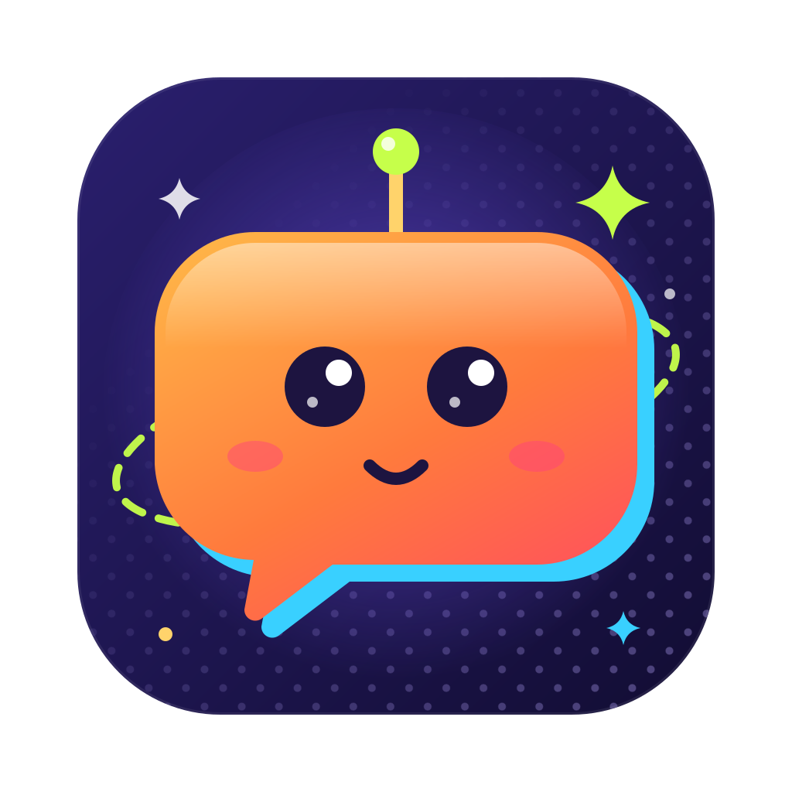

<p align="center"></p>

# openbot

Always-on AI bots that chat like friends and actually do things on a computer, powered by **your Claude
subscription** (through Claude Code) or an **Anthropic API key**.

Written in Rust: a small native desktop app (Tauri) plus a fast server, instead of a 344 MB Electron app.

```
 ┌──────────────── your Mac / laptop ───────────────┐            ┌──────── Windows PC (on 24/7) ────────┐
 │  openbot app (window)                            │   network  │  openbot-server                        │
 │    └─ built-in local server ◄── "This computer"  │ ─────────► │    └─ runs `claude -p` for each bot    │
 │                                 "Remote computer"│  + token   │       in C:\Users\you\OpenBot\<bot>     │
 └──────────────────────────────────────────────────┘            └────────────────────────────────────────┘
```

* **openbot app**: the chat window (sidebar of bots, chat, settings). Works on macOS and Windows.
* **openbot-server**: the "computer" your bots live on. Run it on a PC that stays on, and the bots keep
  working while your laptop is closed.

## What's in this folder

| Path | What it is |
|---|---|
| `ui/` | The interface (HTML/CSS/JS, no build step). Served by the Rust server. |
| `crates/openbot-core/` | The engine: API server, Claude Code runner, approvals, storage. |
| `crates/openbot-server/` | The headless always-on server program (`openbot-server`). |
| `apps/openbot/src-tauri/` | The desktop app (window + built-in local server). |
| `scripts/windows/install-host.ps1` | One-time setup to make a Windows PC an always-on bot computer. |
| `docs/API.md` | How the UI talks to the server. |

## How it uses your Claude subscription

openbot doesn't log in to Claude itself. For each message it runs the official Claude Code program
(`claude -p ...`) on the bot's computer, and Claude Code uses whatever login that computer has.
That's how Claude Code is meant to be scripted, and it's for your own personal use.
**Settings › Claude Account** lets you switch to an Anthropic API key instead (billed per use by Anthropic).

Each bot is one long Claude Code conversation (`--resume`), with its own folder for files.

## Run it on this Mac

1. Install Rust (https://rustup.rs) and Claude Code (https://claude.com/claude-code). Run `claude` once and log in.
2. Install the Tauri build tool (one time, takes a few minutes):
   ```bash
   cargo install tauri-cli --version "^2" --locked
   ```
3. Build the app:
   ```bash
   cd apps/openbot/src-tauri
   cargo tauri build
   ```
   The app is at `target/release/bundle/macos/openbot.app`. Drag it into Applications.

   To just try it without packaging: `cargo run -p openbot`.

## Make your Windows PC the 24/7 computer

On the **Windows PC**:

1. Install **Rust**: https://rustup.rs (accept the "Visual Studio C++ Build Tools" step when it asks).
2. Install **Claude Code** in PowerShell: `irm https://claude.ai/install.ps1 | iex`.
   Then run `claude` once and log in with your Claude account.
   (Claude Code on Windows also needs **Git for Windows**: https://git-scm.com/download/win)
3. Copy this whole `openbot` folder to the PC and build the server:
   ```powershell
   cargo build --release -p openbot-server
   ```
4. Open **PowerShell as Administrator** in the folder and run:
   ```powershell
   Set-ExecutionPolicy -Scope Process Bypass
   .\scripts\windows\install-host.ps1 -KeepAwake
   ```
   This starts openbot-server every time Windows boots (even before you sign in), restarts it if it
   crashes, opens port 7777 for your private network, and stops the PC from sleeping while plugged in.
   At the end it prints an **address** and a **token**.

   (Prefer to try it first? Just run `target\release\openbot-server.exe` in a normal window.)

On your **Mac**: open openbot › Settings › **Computer** › **Remote computer**, paste the address and
token, click **Test connection**, then **Connect**. Your bots now live on the Windows PC.

### Reaching the PC from anywhere (recommended: Tailscale)

At home, the PC's local address (like `http://192.168.1.20:7777`) works. To reach it from anywhere,
safely, install **Tailscale** (free, https://tailscale.com) on both computers and sign in to the same
account. Then use the PC's Tailscale name, for example `http://my-windows-pc:7777`.
Don't forward port 7777 on your router: openbot speaks plain HTTP, and Tailscale encrypts the traffic for you.

### Useful commands on the PC

```powershell
openbot-server token        # show the pairing token again
openbot-server new-token    # make a new token (disconnects old pairings)
Get-Content "$env:LOCALAPPDATA\openbot\openbot-server.log" -Tail 50   # see the log
.\scripts\windows\install-host.ps1 -Uninstall                         # remove the auto-start
```

Data lives in `%APPDATA%\openbot` (bots, chats, settings). Bot folders are in `%USERPROFILE%\OpenBot`.

## Permissions (Settings › Permissions)

| Mode | What happens |
|---|---|
| Ask every time (default) | The bot shows an **Allow / Always allow / Deny** card in the chat before doing anything risky. |
| Let Claude decide | Claude Code's safety check approves routine actions and only asks about risky ones. |
| Auto-approve file edits | File changes go through; commands still ask. |
| Allow everything | Nothing asks. Only use this on a computer you're fine with the bot fully controlling. |

"Always allow" remembers that exact action. You can see and remove the list under Permissions.

## Building Windows/Mac installers automatically

Push this folder to a GitHub repository. `.github/workflows/build.yml` builds `openbot-server.exe`,
the Windows installer and the Mac `.dmg`. Download them from the repository's **Actions** tab.

## Developing the UI

Run the server with `OPENBOT_UI_DIR` pointing at `ui/` and it reads the UI files from disk on every
reload, so you don't need to rebuild:

```bash
OPENBOT_UI_DIR=$PWD/ui cargo run -p openbot-server -- --local-only
```

---

openbot is an independent project. It is not affiliated with or endorsed by Anthropic.
